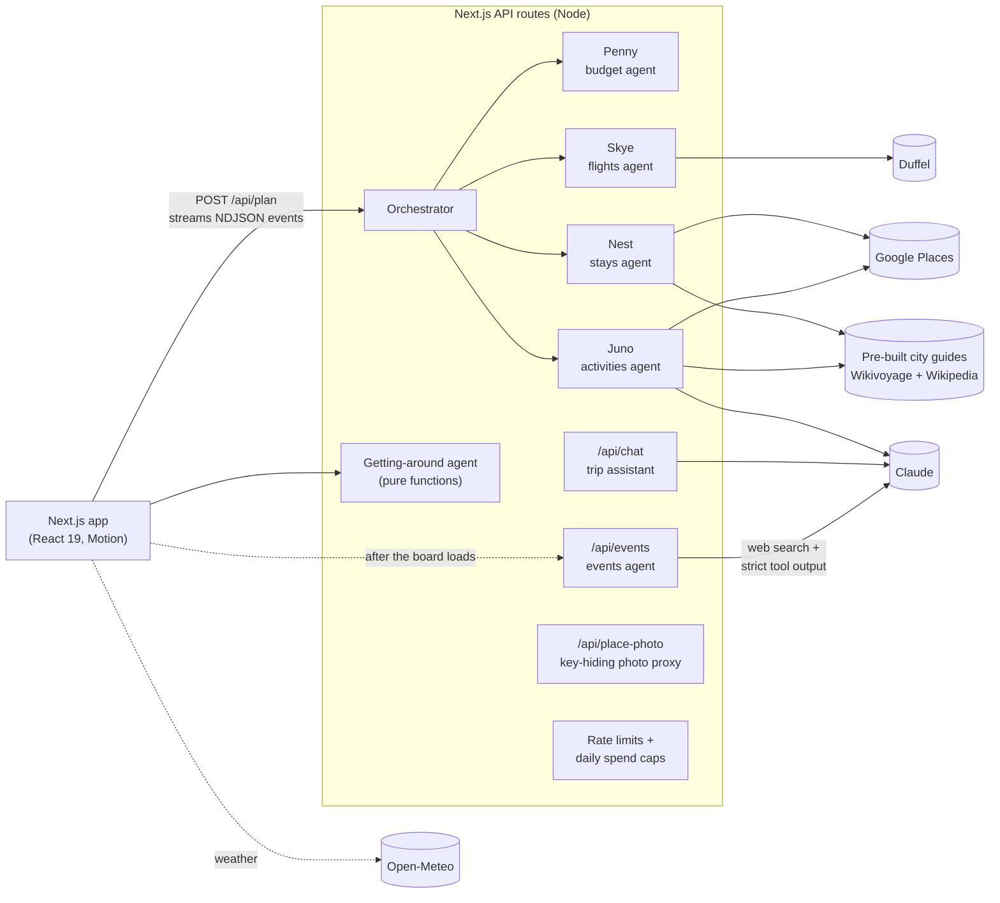

# Roamwise

**Set a budget and a vibe. A crew of four AI agents plans the whole trip: flights, a real hotel, and a swipeable deck of real things to do, all kept inside your budget.**

**[Live demo →](https://roamwise-advika6.vercel.app)** · Open a finished Lisbon, Tokyo or Paris trip in one click, no sign-up.

<!-- Demo GIF: record ~15s of the app, save as docs/demo.gif, then replace this comment with:  -->

Built with **Next.js 16 · React 19 · TypeScript · Claude (Anthropic SDK) · Google Places · Motion · Vitest**.

[](https://github.com/advikarathi/roamwise/actions/workflows/ci.yml)

---

## What it does

- **Plans in seconds, live.** Four agents (budget, flights, stays, activities) work in parallel; their progress streams to an animated "crew" screen.
- **Real places, real photos.** Hotels, restaurants and sights come from Google Places, Wikivoyage and Wikipedia, each with a photo, rating and map link. 50 cities are pre-built, so they load instantly.
- **What's on while you're there.** An events agent searches the web (Claude + web search) for concerts, festivals, shows and matches on your exact dates; keep one and it lands on that day.
- **Getting around.** Each day shows travel time between stops (walk, transit or taxi) and a one-tap Google Maps route; plus the airport-to-hotel transfer.
- **Swipe to plan.** Swipe right on ideas; they drop into a day-by-day itinerary that dodges rainy days in the forecast.
- **Edit everything.** Move plans between days, reorder, remove, add your own, or ask the crew in plain English ("make it cheaper", "nonstop", "add a beach day").
- **Ask the trip assistant.** A chatbot that knows your flight, hotel, budget and every day of the plan (Claude, with a built-in fallback).
- **Plan with friends.** Share a link; everyone swipes on their own phone and the plan keeps what most of the group likes.
- **Book and share.** Prefilled links to Google Flights, Kayak, Booking.com and Airbnb; email the plan; export it as a page.

## Architecture



**How a plan is made** (`lib/agents/orchestrator.ts`):

1. **Penny** splits the budget (40% flights, 42% stay, 14% activities, 4% local transit).
2. **Skye** (flights) and **Nest** (stays) search in parallel while the city center is geocoded.
3. **Juno** builds a deck of 50–70 ideas around the chosen stay from four sources at once (Claude, hand-written picks, Google Places, the city guide), removes duplicates (same name, same article, or the same spot within ~120 m), and interleaves vibes so the deck isn't ten museums in a row.
4. **Penny** picks the flight + stay combination that fits and explains any rebalancing.

Each agent emits status events as it works; `POST /api/plan` streams them as newline-delimited JSON, which drives the crew animation.

## Engineering decisions

These are the parts I'd want to talk about in an interview.

**Never depend on a live call.** Every data source has a fallback, in order: paid API → pre-built guide → live free API → generic sample. A trip always comes back, even with no API keys and no network to Wikimedia.

**Pre-built city guides.** Free APIs (Wikipedia, Wikivoyage, Commons) rate-limit hard. In development I got the machine blocked by firing parallel photo lookups. The fix was architectural: `scripts/build-guides.mts` crawls 50 cities *once*, slowly (one request at a time, 2.5 s apart, honoring `Retry-After`, with a circuit breaker and resumable runs), and writes `public/guides/<CODE>.json`. At plan time those cities make **zero** Wikimedia API calls; only image files load.

**Photo accuracy over photo coverage.** Wrong photos are worse than none. A photo is accepted only if:
- it comes from the place's own Wikidata entry, *or*
- its file title contains every distinctive word of the place's name (and the city, unless the name is unique enough), *or*
- for Wikidata name matches, the item's coordinates are within 1.5 km of the listing.

Lead images that are logos, maps, flags or diagrams are rejected by filename. This caught real bugs: "Mercure Porto Centro" was about to show the Mercure in *Bologna*; "Seafood feast at a cervejaria" was matching a *cevicheria*.

**Resilient HTTP layer** (`lib/providers/places.ts`):
- in-flight request de-duplication;
- a one-day response cache;
- a serialized request queue with a gap between requests;
- exponential backoff that honors `Retry-After`;
- a per-host circuit breaker (6 throttles in 60 s → back off for 10 minutes);
- MediaWiki's "HTTP 200 with an error body" responses are treated as failures, never cached. That was a real bug that pinned failures in cache for a day.

**Typed AI output, not parsed prose.** Activity ideas and change requests use the Anthropic SDK's structured outputs (Zod schemas), so responses always match the expected shape. The events agent searches with Claude's server-side `web_search` tool and returns results by calling a `strict` client tool, handling `pause_turn` for long searches. Every Claude call has a timeout, a refusal check, and a non-AI fallback.

**Slow work off the critical path.** Planning returns in seconds; the events search (about a minute) starts after the board is on screen and streams into its own section and the deck.

**Keys never reach the browser.** Google photos are served through `/api/place-photo`, which resolves the photo reference server-side and redirects. Claude, Duffel and Resend calls all run in API routes.

**Safe to put on the internet.** Per-visitor rate limits on planning, chat, email and photos, plus daily caps on paid Google calls (`lib/rateLimit.ts`). Past a cap, the app quietly falls back to the free guides instead of failing.

**Honest data.** Sample and test fares are labeled as such, estimated hotel prices say "estimate", and booking links don't apply filters (like "nonstop") that only a fake fare implied.

## Data sources

| Source | Used for | Cost | Without it |
|---|---|---|---|
| Google Places (New) | Hotels, restaurants, sights, photos, ratings | Paid, free monthly allowance, daily cap | Pre-built guides |
| Wikivoyage | Real hotels and things to do per city | Free (pre-built) | Sample data |
| Wikipedia / Wikidata / Commons | Landmarks, descriptions, photos | Free (pre-built) | Colored banners |
| Duffel | Real flights | Test free; live per-search fees | Sample fares from distance |
| Claude (Anthropic) | Trip assistant, extra activity ideas, parsing change requests | Paid per use | Built-in answers and rules |
| Open-Meteo | Forecast, or last year's weather for far-off dates | Free | No weather |
| Resend | Emailing the plan | Free tier | Opens the user's mail app |
| OurAirports | ~4,000 airports, 233 countries | Public domain (bundled) | — |

## Tests

```bash
npm test          # Vitest: 33 tests
npm run typecheck
```

The tests cover the logic that's easy to get subtly wrong:
- the budget split and flight + stay selection;
- the day-plan editor (moves, removals, custom plans, events pinned to their date);
- price parsing across currencies (ignoring group sizes, times and years);
- Wikivoyage wikitext parsing;
- booking links (sample fares never apply fake filters; Noida flies via Delhi);
- change-request parsing, routing estimates, and the chatbot's built-in answers.

GitHub Actions runs type-check, tests and a production build on every push.

## Run it locally

```bash
npm install
npm run dev          # http://localhost:3000
```

With **no keys** everything still works: 50 pre-built cities with real places and photos, sample fares, and built-in chat answers. Add keys in `.env.local` to turn on live data:

| Variable | Turns on |
|---|---|
| `GOOGLE_PLACES_API_KEY` | Real hotel/restaurant photos and ratings everywhere |
| `ANTHROPIC_API_KEY` | Claude trip assistant and extra activity ideas (`ANTHROPIC_MODEL` to override; default `claude-opus-5-5`) |
| `DUFFEL_TOKEN` | Real flights (`duffel_test_…` returns practice data) |
| `RESEND_API_KEY`, `RESEND_FROM` | Sending the plan by email |
| `UPSTASH_REDIS_REST_URL`, `UPSTASH_REDIS_REST_TOKEN` | Shared trip links that survive restarts |
| `WIKIMEDIA_CONTACT` | Contact sent in the User-Agent, per Wikimedia policy |
| `GOOGLE_DAILY_SEARCH_CAP`, `GOOGLE_DAILY_PHOTO_CAP`, `EVENTS_DAILY_CAP` | Spending caps (defaults 400, 3,000 and 150/day) |

### Scripts

| Command | What it does |
|---|---|
| `npm run dev` / `build` / `start` | Next.js |
| `npm run guides:build [-- LIS OPO]` | Crawl or refresh pre-built city guides (slow on purpose; re-running fills gaps) |
| `npm run demos:build` | Rebuild the one-click demo trips |
| `npm test` / `npm run typecheck` | Tests and type-check |

## Project layout

```
app/                     pages and API routes (plan, revise, events, chat, email, place-photo, trips)
components/              Setup, crew screen, trip board, swipe deck, itinerary editor, chat
lib/agents/              orchestrator + budget, flights, stays, activities, revise
lib/providers/           Google Places, Wikivoyage, Wikipedia geosearch, Duffel, Claude, events (web search), samples
lib/                     links, routes (getting around), rate limits, trip text (chat brief + email), guide loaders
tests/                   Vitest suite
public/guides/           pre-built city guides (50 cities)
public/demos/            one-click demo trips
scripts/                 guide, demo and airport builders
```

## Deploy

Push to GitHub, import on [Vercel](https://vercel.com), and add the env vars. `next.config.mjs` ships the city guides with the API routes. Rate limits and caps are in-memory per server instance, so they're soft limits: enough to stop runaway costs, not exact quotas (use Redis for hard limits).

## Limitations

- Hotel prices are estimates (Google doesn't publish hotel rates); booking links show live prices.
- Exact-flight links need a live Duffel key; sample and test fares link to the route and dates instead.
- Cities outside the 50 pre-built guides use live free APIs and are less polished.
